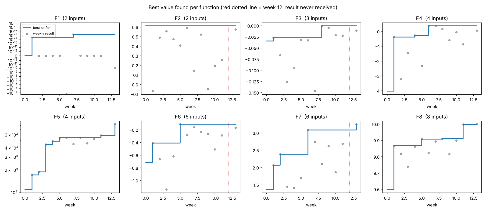
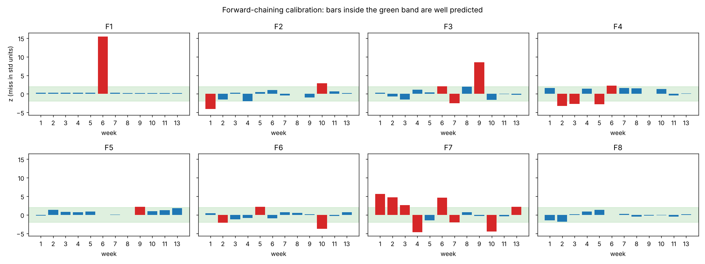

# Black-Box Optimisation Capstone: finding the best inputs for eight hidden functions

Imperial College Professional Certificate in Machine Learning and Artificial Intelligence.

## NON-TECHNICAL EXPLANATION OF YOUR PROJECT

Imagine eight sealed machines. You can choose a setting for each one, and it tells you only a single number: how well that setting worked. You get one try per machine each week, and you want the best setting you can find. I used a computer model that learns from every result and also says how sure it is. Before trusting it, I tested whether its confidence was honest. Where it was, I took bolder steps. Over 13 weeks this clearly improved six of the eight machines, some several times over. The two hardest machines barely improved, which taught me where this approach runs out of information.

## DATA

- **Source.** The course supplied a starting set of observations for each function (`data/initial_data/function_N/initial_inputs.npy` and `initial_outputs.npy`). All later points are my own weekly queries and the results returned by the course. How the course generated the functions is not disclosed (they are black boxes by design).
- **Size.** Every input is a number between 0 and 1. The functions have 2, 2, 3, 4, 4, 5, 6 and 8 inputs. The starting sets hold 10, 10, 15, 30, 20, 20, 30 and 40 points. I submitted 13 queries per function. The week-12 results never arrived, so 12 results are known per function.
- **One combined file.** `data/queries.csv` holds every observation (columns: `function`, `week`, `x1` to `x8`, `y`, `source`). Week 0 is the course data. The week-12 rows have a blank `y`.
- **Caveats.** Queries were chosen using earlier results, so the points are not independent samples. Some functions have very few points for their size. See [`docs/datasheet.md`](docs/datasheet.md) for details per function.

## MODEL

A **Gaussian process (GP) surrogate** with an **upper confidence bound (UCB)** rule. After each result the GP is refitted to all data and predicts both a value and an uncertainty for any input. UCB then picks the next input by `predicted value + beta * uncertainty`, balancing exploitation (high prediction) against exploration (high uncertainty).

I chose a GP because it gives an uncertainty estimate with very few points, which is the situation here (20 to 50 points per function). I tested linear, SVM and neural-network models and local models; the GP predicted held-out points better or equally well.

Two additions made the biggest difference:
- A **forward-chaining calibration check**: refit before each past query, predict it, and see whether the miss is consistent with the model's stated uncertainty. It decided how bold each function was allowed to be.
- **TuRBO**, a trust-region version of Bayesian optimisation, used on F8 and F5 (the two functions that passed the check).

Full description: [`docs/model_card.md`](docs/model_card.md).

## HYPERPARAMETER OPTIMISATION

| Setting | Values tried | How chosen |
|---|---|---|
| Kernel | RBF, Matern 1.5, Matern 2.5 | Highest log marginal likelihood (LML) per function |
| Smallest allowed length-scale | 0.05, 0.1, 0.2, 0.5 | LML; added after the length-scale collapsed on flat data (F1, F2) |
| Noise level (`alpha`) | 1e-6 to 1e-1 (finer grid for F6) | LML; F6 also checked against a repeated input |
| Exploration weight (`beta`) | 1.0, 1.96, 3, 5 | Compared each week; chosen per function |
| Output transform | none, log (F5 only) | Only where the calibration check showed a problem |
| Duplicate threshold | 0.02 | Fixed; proposals closer than this to an earlier query are flagged |

Caveat: several settings often had almost identical LML, so the top-ranked setting can change between machines or after one more data point. Random seeds are fixed (42) for repeatability.

## RESULTS

Best value found per function, compared with the best in the course data:

| Function | Inputs | Course data best | My best | Found in week | Leaderboard place (of 40) |
|---|---|---|---|---|---|
| 1 | 2 | 0 (7.7e-16) | about 0 (1.4e-8) | 7 | not listed |
| 2 | 2 | 0.611 | 0.611 | course data | not listed |
| 3 | 3 | -0.0348 | -0.00073 | 8 | 3rd |
| 4 | 4 | -4.03 | 0.368 | 6 | 34th |
| 5 | 4 | 1,089 | 8,267 | 13 | 23rd |
| 6 | 5 | -0.714 | -0.114 | 5 | 12th |
| 7 | 6 | 1.36 | 3.248 | 13 | 7th |
| 8 | 8 | 9.598 | 9.998 | 13 | 5th |

Leaderboard places were reported to me by the course and may predate the final results.



**What I learned**
- **Check the model before trusting it.** F8 passed the calibration check, and the TuRBO prediction for week 13 (9.998, range 9.996 to 9.9995) matched the result (9.9983). F4 and F7 failed the check, so I used only small steps there.
- **Fix basic problems first.** An automatic duplicate check and a log transform for F5 (outputs span tens of thousands of times) did more than any fancier model.
- **Noise matters.** F6 returned different values for the same input (-0.114, -0.161, -0.168), so its best is probably a lucky draw.
- **Boldness paid off once.** F5's final query went to a boundary corner (`[1, 1, 0.9787, 1]`) and returned 8,267, well above the model's prediction of about 6,500. Testing such corners earlier would have been better.
- **Limits.** F1 and F2 had almost no usable signal, and F2 never beat the starting data.



## HOW TO RUN

```bash
git clone <this repository>
cd <repository folder>
pip install -r requirements.txt
jupyter notebook notebooks/BBO_capstone_final.ipynb      # takes about 1 to 5 minutes
```

The notebook reads `data/queries.csv` and uses the helper code in `scripts/utils/`.

## REPOSITORY LAYOUT

```
README.md                      this file
requirements.txt               Python packages
data/
  queries.csv                  every query and result (week 0 = course data)
  initial_data/function_1..8/  course data as .npy files
notebooks/
  BBO_capstone_final.ipynb     main notebook: method and results
  turbo_capstone.ipynb         general TuRBO notebook used for F5 and F8
  weekly_history/              notebooks from individual weeks (record of the work)
scripts/
  utils/                       helper code used by the notebook (GP, UCB, calibration, TuRBO)
  pipeline/                    weekly pipelines as run
  diagnostics/                 one-off tests (surrogate comparisons, sensitivity, box pick)
results/
  results_per_week.csv         outputs per function per week
  best_so_far.png, calibration.png
  history/                     candidate tables from earlier weeks
docs/
  model_card.md                what the model does, how well, and where it fails
  datasheet.md                 the data, function by function
  BBO_capstone_overview.pdf    short project overview
```

## REFERENCES

- Eriksson, D., Pearce, M., Gardner, J., Turner, R. and Poloczek, M. (2019). Scalable global optimization via local Bayesian optimization (TuRBO). *NeurIPS*.
- Rasmussen, C. and Williams, C. (2006). *Gaussian Processes for Machine Learning*. MIT Press.
- Pedregosa, F. et al. (2011). Scikit-learn: machine learning in Python. *JMLR*.
- Gebru, T. et al. (2021). Datasheets for datasets. *Communications of the ACM*.
- Mitchell, M. et al. (2019). Model cards for model reporting. *FAT\**.
